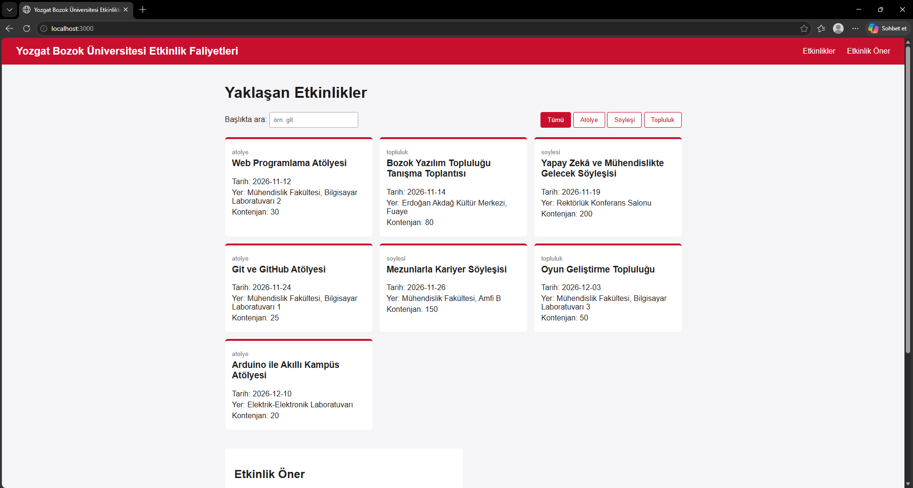

# Kampüs Etkinlik Panosu

BMH231 Web Programlama Ödev 2. Bozok Üniversitesi'ndeki etkinlikleri listeleyen basit bir web sitesi yaptım. HTML, CSS ve JavaScript ile yaptım, veriler Node.js ile yazdığım sunucudan geliyor.

## Nasıl çalıştırılır

Bilgisayarda Node.js kurulu olmalı.

```
git clone https://github.com/EmreYurekdeler/bmh231-odev2
cd bmh231-odev2
npm start
```

Sonra tarayıcıda http://localhost:3000 adresine girin.

## Özellikler

- Etkinlikler kart şeklinde listeleniyor
- Türe göre filtreleme (Atölye, Söyleşi, Topluluk)
- Başlığa göre arama
- Etkinlik önerme formu (boş alan, tarih ve e-posta kontrolü var)


## API

- `GET /api/etkinlikler` → tüm etkinlikler
- `GET /api/etkinlikler?tur=atolye` → sadece atölyeler
- `GET /api/etkinlikler/3` → id'si 3 olan etkinlik
- Olmayan id için 404, GET dışındaki istekler için 405 döner

## Proje yapısı

```
bmh231-odev2/
├── sunucu.js          # Node.js http sunucusu ve JSON API
├── etkinlikler.json   # Etkinlik verileri
├── package.json       # "npm start" komutu
├── .gitignore
├── README.md
└── public/
    ├── index.html     # Sayfa iskeleti
    ├── stil.css       # Görünüm
    └── betik.js       # fetch, filtre, arama, form doğrulama
```

## Geliştiren

Emre Yürekdeler – BMH231 Web Programlama, 2026–2027 Güz


## Ekran görüntüsü



